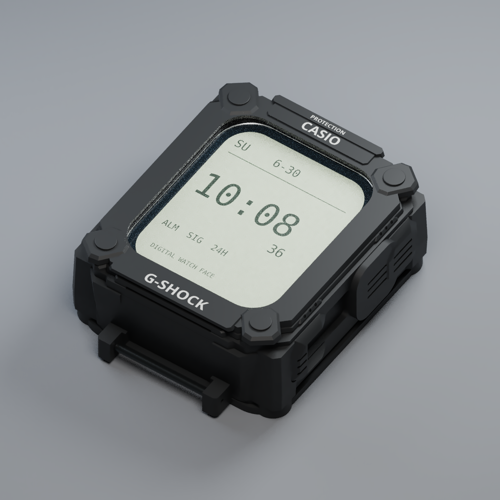

# GX56 V13 — téléchargement pour impression3D

Cliquez sur le bouton pour télécharger les deux modèles STL sur votre ordinateur.

## Télécharger séparément

| Pièce | Matériau | Fichier |
|---|---|---|
| 01 · Pièce supérieure | TPU95A | [Télécharger STL —12.7Mo](https://raw.githubusercontent.com/orca2005/abdessamad/refs/heads/gx56-v13-downloads/files/GX56_V13_01_UPPER_TPU95A.stl) |
| 02 · Base inférieure | PA12 rigide | [Télécharger STL —3.9Mo](https://raw.githubusercontent.com/orca2005/abdessamad/refs/heads/gx56-v13-downloads/files/GX56_V13_02_LOWER_PA12.stl) |

## Pour l’imprimeur

- Unités **mm**, échelle **100%**. Deux pièces principales.
- Prototype: vérifier les dimensions et le fit sur la montre avant utilisation.
- La fenêtre transparente **polycarbonate1.5mm** est distincte des deux pièces imprimées.
- Les fichiers STL sont des modèles3D. Aucun logiciel à installer pour les transmettre à l’imprimeur.

